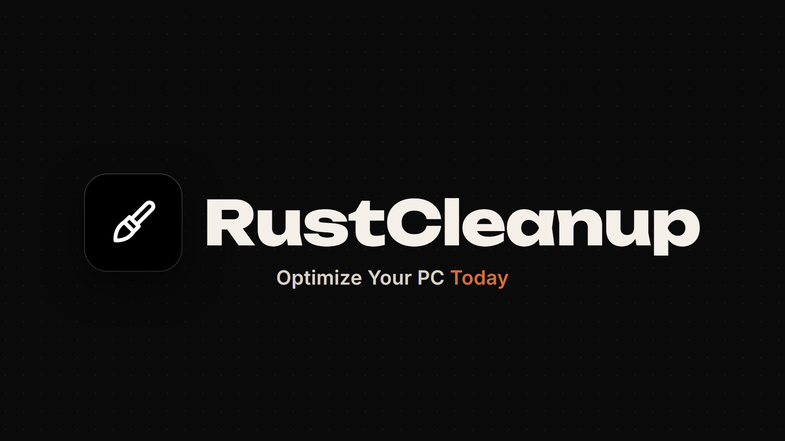
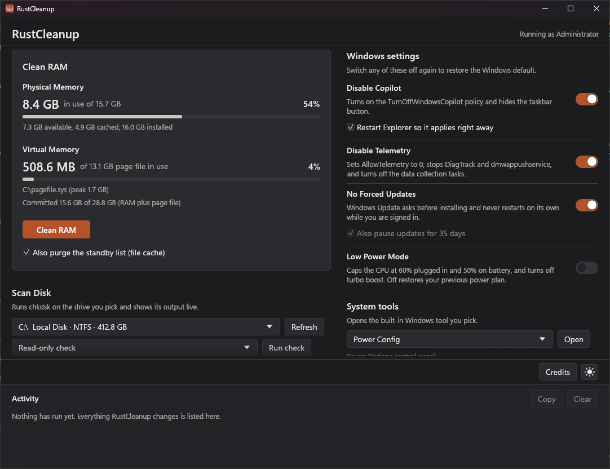
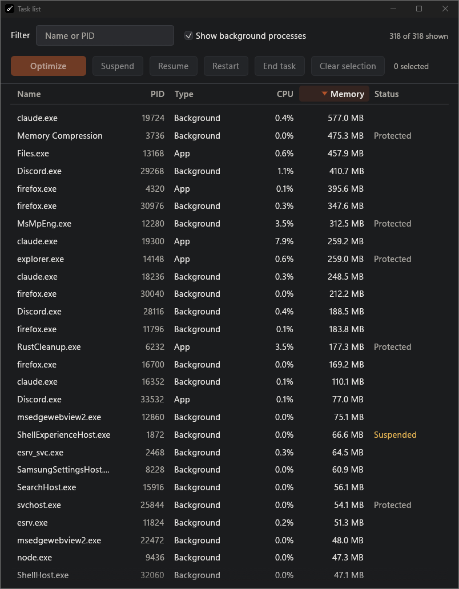
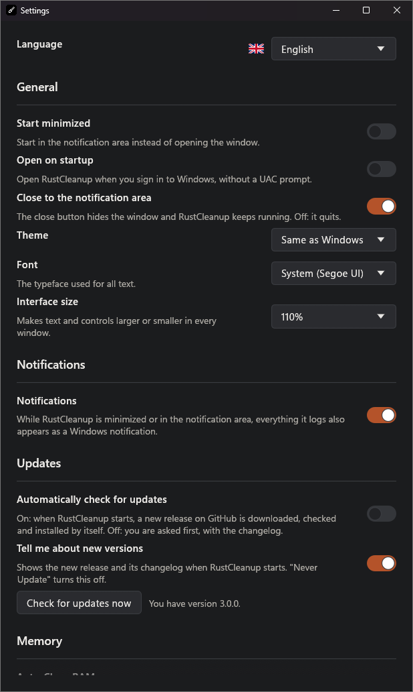

**[Download the latest release](https://github.com/RealAnxiousGit/RustCleanup/releases/latest)**

> RustCleanup changes system settings (registry policies, services, power plans).
> Every switch can be turned off again to restore the Windows default, but it's still a
> good idea to create a restore point first (`Win + R`, then `SystemPropertiesProtection`).

## Features



| Feature | What it does | How to undo |
|---|---|---|
| **Clean RAM** | Trims the working set of every process (`EmptyWorkingSet`), flushes the modified page list and, optionally, purges the standby list (file cache) via `NtSetSystemInformation`. Reports how much memory was freed. | Nothing to undo: Windows pages memory back in on demand. |
| **Physical Memory** | Live RAM in use, out of usable and installed RAM, plus available and cached memory, refreshed every second. The bar turns yellow above 75% and red above 90%. | n/a |
| **Virtual Memory** | Page file size, usage and peak for each page file, plus the commit charge (RAM plus page file). The bar turns yellow above 75% and red above 90%. | n/a |
| **Scan Disk** | Shows how much of the selected drive is used, how much is available and its total size. **Manage Storage** opens Windows Settings at Storage for the system drive. For any other drive it goes on to Storage used on other drives and opens that drive's own page. Run `chkdsk` on any mounted drive: Output streams live into its own window. Modes: **Read-only check** (`chkdsk X:`) on any drive, or **Online scan** (`chkdsk X: /scan`) on NTFS drives. | Read-only: never modifies the disk. |
| **Disable Copilot** | Sets `TurnOffWindowsCopilot = 1` under `HKCU` and `HKLM\Software\Policies\Microsoft\Windows\WindowsCopilot`, hides the taskbar button, and can restart Explorer so it applies right away. | Switch off: the values are deleted. |
| **Disable Telemetry** | Sets `AllowTelemetry = 0` (policy and system keys), disables and stops `DiagTrack` and `dmwappushservice`, and disables the telemetry scheduled tasks through Task Scheduler. Tasks missing on your Windows build are skipped. | Switch off: policies removed, services set back to Automatic/Manual, tasks re-enabled. |
| **No Forced Updates** | Under `HKLM\SOFTWARE\Policies\Microsoft\Windows\WindowsUpdate\AU`: `NoAutoRebootWithLoggedOnUsers = 1`, `AUOptions = 2` (ask before download and install). Can also pause updates for 35 days, the most Windows allows. | Switch off: all policy and pause values removed. |
| **Optimize Task** | A live task list (App or Background, CPU %, memory, status) in its own window, with a filter. Click any column to sort by it, and again to reverse. Select like in File Explorer: click, Ctrl+click, Shift+click, Ctrl+A. Memory turns yellow at 4% and red at 10% of your RAM. For the selected processes: **Optimize** (trim memory and set Below Normal priority), **Suspend**, **Resume**, **Restart** (close and open again with the same command line) and **End task**. | Resume suspended processes. Anything still suspended is resumed when RustCleanup exits. |
| **Low Power Mode** | Creates and activates a "RustCleanup Low Power" plan: CPU capped at 60% plugged in and 50% on battery, turbo boost off, passive cooling. | Switch off: your previous power plan is restored and the custom plan deleted. |
| **System Tools** | Opens Power Config, Disk Cleanup, Disk Management, Performance Monitor, Task Manager, Resource Monitor, Windows Security, Device Manager, Settings, Command Prompt or Command Prompt [Admin]. | n/a |
| **Feedback** | Opens a Compose Feedback window for a **Bug Report** or **Suggestion**: a title, a body that takes pasted screenshots, a right-click menu with Cut, Copy, Paste, Select All and **Hyperlink**. **Send** opens a filled-in GitHub issue and a folder with the screenshots to drag into it; **Send it by email instead** works without a GitHub account. Nothing is sent until you submit it yourself. | n/a |

### Task list


### Tray icon and notifications
- **The tray icon stays** in the notification area while RustCleanup runs. Click it to open the window.
- **Closing the window hides RustCleanup** to the notification area, so it keeps running (you can turn this off in Settings).
- **Right-click the tray icon** for **Open App**, **Clean RAM**, **Open task list**, **Settings**, **Credits** and **Exit**. The task list, Settings and Credits open on their own, without the main window. Only **Exit** quits.
- While the window is minimized or in the tray, finished jobs, warnings and errors from the Activity log also appear as Windows notifications.
- **Only one copy runs.** Opening RustCleanup again brings up the copy that is already running.

### Settings


The **Settings** button sits between **Credits** and the theme button. **Changelog**, next to **Credits**, shows the release notes of every version, newest first, each with its title and release date. Scroll down to read further back, or use the menu button next to the title to jump straight to a version. It also opens by itself on the first start after an update. Settings are saved in `HKCU\Software\RustCleanup`.

| Setting | What it does |
|---|---|
| **Language** | English, Español, Português, Français, Deutsch, Italiano, Nederlands, Polski, Türkçe, Русский, 日本語, 中文. Follows your Windows display language on first launch. |
| **Start minimized** | Starts in the notification area instead of opening the window. |
| **Open on startup** | Adds a Task Scheduler logon task with highest privileges, so RustCleanup starts at sign-in without a UAC prompt. (The usual Run key can't be used: Windows skips programs that need admin rights there.) |
| **Close to the notification area** | On: the close button hides the window. Off: it quits. |
| **Theme** and **Interface size** | Same as Windows, Light or Dark; 90% to 175%. |
| **Font** | System (Segoe UI), Arial, Times New Roman, Light UI (Segoe UI Light), Comic Sans MS, Verdana, Georgia, Tahoma, Calibri, Trebuchet MS or Consolas. |
| **Notifications** | Turns the Windows notifications off or on. |
| **Automatically check for updates** | On: a new release is downloaded, checked against its published SHA-256, installed, and RustCleanup restarts on the new version by itself. Off: RustCleanup shows the new version's changelog with **Update Now** and **Never Update** (or close it to decide later). |
| **Auto-Clean RAM** | Cleans RAM by itself when memory use goes above the amount on the slider (50% to 95%), at most once every 2 minutes. |
| **Hardware-accelerated UI** | Draws the interface with Direct3D 12 instead of OpenGL. Smoother on some GPUs, but about 335 MB of memory instead of about 100 MB. Needs a restart. |

### Light and dark mode
The button to the right of **Settings** switches themes: a sun means "switch to Light Mode", a crescent moon means "switch to Dark Mode". The change fades over about a quarter of a second, or happens instantly if Windows animation effects are turned off. On first launch RustCleanup follows your Windows app theme, then remembers your choice.

### Safety built in
- **Protected processes.** csrss, wininit, winlogon, services, lsass, Defender and others can't be suspended or ended, and neither can RustCleanup itself. They can only be trimmed.
- **Windows components.** Explorer, dwm, svchost, sihost, fontdrvhost and audiodg show as **System** in the task list. Like in Task Manager they can be ended, and Windows starts them again by itself; Explorer can also be restarted, and RustCleanup starts it again with your normal rights. They can't be suspended, and RustCleanup warns before acting on them.
- **End task asks first.** It lists which programs will lose unsaved work.
- **Switches show the real state.** They are read back from Windows on launch and after every change, so a failed change never leaves a switch showing the wrong state.
- **Nothing is left behind.** Suspended processes are resumed and running scans are stopped when RustCleanup exits.
- **No surprise programs.** System tools are started by their full `System32` path, never looked up on `PATH`. Links and the normal Command Prompt are started by the desktop's Explorer, so they run as you and don't inherit admin rights.
- **No scripts.** RustCleanup never runs PowerShell or any other script host. Scheduled tasks are changed through the Task Scheduler API, the same way the Task Scheduler window does it.
- **No crash on errors.** System calls never `unwrap()`. Every failure is written to the Activity log.

## Using it

1. Download `RustCleanup.exe` from [Releases](https://github.com/RealAnxiousGit/RustCleanup/releases/latest).
2. Double-click it and choose **Yes** on the UAC prompt (Administrator rights are required).
3. Use the buttons and switches. Everything RustCleanup does is written to the **Activity** log. **Copy** puts the log on the clipboard.

Windows SmartScreen may warn about an unsigned app: click **More info**, then **Run anyway**. Each release also has `RustCleanup.exe.sha256`, so you can check the download with `certutil -hashfile RustCleanup.exe SHA256`. If an antivirus flags it, see [False positives](#false-positives).

### False positives
2.0.1 was flagged by Microsoft Defender as `Trojan:Win32/Bearfoos.A!ml`. That is a machine-learning guess, not a known virus: 2.0.1 ran hidden PowerShell to create its startup task, which is also what a lot of malware does. 2.0.2 removes all PowerShell use. The exe is not code-signed yet, and new unsigned programs are judged by behaviour, so if your antivirus still flags it, please report it as a false positive (for Defender: https://www.microsoft.com/en-us/wdsi/filesubmission). The source and build steps are below, so you can also build the exe yourself.

### Notes
- Windows 11 Home and Pro treat `AllowTelemetry = 0` as "Required" (level 1), the lowest level those editions allow. Enterprise and Education honour level 0.
- Copilot policies are written to the signed-in user's `HKCU`. If you elevate with a different admin account, the HKLM policy still applies machine-wide.
- On recent Windows 11 builds Copilot is also a Store app. The policy hides and disables it; you can uninstall the app in Settings, Apps.
- Purging the standby list clears the file cache, so the next launch of a recently used program may be slightly slower.
- A read-only `chkdsk` of a large exFAT drive can take many minutes. The progress line in the Scan Disk window keeps updating while it runs.

## Building from source

### Prerequisites (Windows 11, x64)
1. **Rust** (stable, MSVC toolchain): install from <https://rustup.rs>, or run
   ```powershell
   winget install Rustlang.Rustup
   ```
2. **Visual Studio Build Tools** with the *Desktop development with C++* workload, which provides the MSVC linker, `rc.exe` and the Windows SDK:
   ```powershell
   winget install Microsoft.VisualStudio.2022.BuildTools --override "--quiet --add Microsoft.VisualStudio.Workload.VCTools --includeRecommended"
   ```

### Build
```powershell
git clone https://github.com/RealAnxiousGit/RustCleanup
cd RustCleanup
cargo build --release
```
The output is `target\release\RustCleanup.exe`, a single self-contained file:
- `build.rs` uses `embed-resource` to compile `resources.rc`, which embeds `app.manifest` (`requireAdministrator`, PerMonitorV2 DPI awareness), the icon and the version info. The build fails if the manifest can't be embedded, so you can never get an exe that silently runs without admin rights.
- `.cargo/config.toml` links the C runtime statically (`+crt-static`), so the exe doesn't need the Visual C++ Redistributable.
- eframe is built with the OpenGL (`glow`) renderer instead of its default wgpu renderer, which keeps memory use low.

### Run
- Double-click `target\release\RustCleanup.exe` and accept the UAC prompt, or
- from an **Administrator** terminal: `cargo run --release`.

Running `cargo run` from a normal terminal fails with *"The requested operation requires elevation (os error 740)"*. This is expected and shows the manifest is working.

### Tests
The test binary carries the same manifest. To run the tests without elevating, tell Windows to ignore the manifest for this shell:
```powershell
$env:__COMPAT_LAYER = "RunAsInvoker"; cargo test
```
`every_string_is_translated` fails if any of the 11 language files is missing a string. The tests that change system settings are ignored by default; each puts the setting back afterwards. Run them from an **Administrator** terminal:
```powershell
cargo test -- --ignored --test-threads=1
```
`cargo test desktop_ -- --ignored --test-threads=1`, also from an Administrator terminal, opens every System Tool and the Settings page for each non-system drive, so you can check them by eye.

### Linux
RustCleanup also runs on Linux (x86_64, X11 or Wayland). Download `RustCleanup-x86_64.AppImage` from the release, then:
```bash
chmod +x RustCleanup-x86_64.AppImage
./RustCleanup-x86_64.AppImage
```
It works on Ubuntu 20.04 or newer, Linux Mint 20+, Debian 11+, Fedora 32+, openSUSE Leap 15.3+, Arch and other distros from the same years, and it does not need `libfuse2`. The tray icon needs a panel with system tray (StatusNotifierItem) support: KDE, Cinnamon, Xfce, MATE and Ubuntu's GNOME have it, while plain GNOME (Fedora, Arch) needs the AppIndicator extension. Without one, RustCleanup still runs, and closing the window quits it.

The `.tar.gz` holds the same program as a plain binary. It runs as your own user; choose **Restart as root** at the bottom (it asks for your password through `pkexec`) for the features that need root, such as dropping the file cache, CPU limits and checking disks. Settings live in `~/.config/RustCleanup`.

To build it (Debian or Ubuntu package names):
```bash
sudo apt install build-essential pkg-config libxkbcommon-dev libwayland-dev libx11-dev libxcursor-dev libxrandr-dev libxi-dev libgl1-mesa-dev libdbus-1-dev fontconfig
cargo build --release
```
The output is `target/release/RustCleanup`, which needs the same or a newer glibc than the machine that built it; [`docs/LINUX.md`](docs/LINUX.md) shows the release build that runs on older distros too. Optional at run time: `pkexec`, `baobab` (Manage Storage), `power-profiles-daemon` (Low Power Mode), `ffmpeg` (the Changelog video) and `fonts-noto-cjk` (Japanese and Chinese). [`docs/LINUX.md`](docs/LINUX.md) explains how the Linux code mirrors the Windows code and how to port each new Windows feature.

### RAM stress test (development builds)
Debug builds, and release builds made with `--features stress-test`, can stress-test Clean RAM: helper processes fill RAM with data that cannot be compressed, then Clean RAM runs against them several times and reports what each run freed and how long trimming and purging took. Use **Stress test (development build)** under Clean RAM, or the script:
```powershell
.\scripts\stress-ram.ps1 -SizeMB 4096 -Hogs 8 -Runs 10 -Purge -Csv stress.csv
```
Run it from an **Administrator** terminal to test the real thing; without admin rights only your own processes are trimmed and the standby purge is skipped. The size is capped at 80% of the available RAM. On Linux, `scripts/stress-ram.sh` does the same; run it as root, since freeing other processes' memory and dropping the page cache need root.

### Adding a language
Copy `lang/de.txt` to `lang/<code>.txt`, replace each second line with the translation, then add the language to `Lang` in `src/i18n.rs` (including its `include_str!` line) and a flag in `src/ui/flags.rs`.

## Project layout
The layout follows the code graph in [`docs/graphify/GRAPH_REPORT.md`](docs/graphify/GRAPH_REPORT.md): one module per feature, with shared plumbing kept separate. Open [`docs/graphify/graph.html`](docs/graphify/graph.html) in a browser to explore the graph. After changing code, regenerate it with `graphify update src`.

```
src/
├── main.rs             window setup (eframe/egui), single instance, launch flags
├── app.rs              wires sections, windows, tray and theme together
├── events.rs           worker-to-UI messages, Logger, Jobs (panic-safe job runner)
├── settings.rs         preferences in HKCU\Software\RustCleanup
├── i18n.rs             translations (English text is the key, lang/*.txt)
├── background.rs       launch-time update and startup checks, Auto-Clean RAM
├── ui/                 the interface, one file per section or window
│   ├── memory.rs       Clean RAM: Physical and Virtual Memory
│   ├── disk.rs         Scan Disk and the chkdsk output window
│   ├── tasks.rs        Optimize Task and the task list window
│   ├── tweaks.rs       Windows settings switches and System tools
│   ├── credits.rs      Credits window
│   ├── changelog.rs    Changelog window (every release's notes, with a version menu)
│   ├── settings.rs     Settings window
│   ├── update.rs       new-version window with the changelog
│   ├── flags.rs        flags for the language picker
│   ├── activity.rs     Activity log
│   ├── theme.rs        palettes, fonts, theme fade
│   └── widgets.rs      switch, meter, buttons, theme button, links
└── sys/                everything that talks to Windows (no UI code)
    ├── memory.rs       memory figures, EmptyWorkingSet, standby purge
    ├── disk.rs         drive enumeration and free space
    ├── chkdsk.rs       streaming chkdsk runner
    ├── copilot.rs      Copilot policy
    ├── telemetry.rs    telemetry policies, services, tasks
    ├── updates.rs      Windows Update policies and pause
    ├── power.rs        Low Power Mode plan via powercfg
    ├── process_monitor.rs  task list sampling (sysinfo)
    ├── process_actions.rs  optimize, suspend, resume, restart, end
    ├── tray.rs         tray icon, menu, notifications (Shell_NotifyIconW)
    ├── tools.rs        System Tools launchers
    ├── updater.rs      GitHub release check, download, SHA-256 check, exe swap
    ├── startup.rs      Open on startup (Task Scheduler logon task)
    ├── tasks.rs        Task Scheduler API (ITaskService)
    ├── storage_page.rs drive page in Settings, found with UI Automation
    ├── single_instance.rs  one running copy; a second launch shows the first
    ├── shell.rs        Explorer restart, unelevated links and programs, window helpers
    ├── com.rs          COM setup for the API modules
    ├── command.rs      hidden console tools and output decoding
    ├── privilege.rs    elevation check, token privileges
    ├── registry.rs     winreg helpers
    └── format.rs       sizes and dates
lang/                   one file per language: English line, then its translation
patches/eframe/         eframe 0.37.0 with a fix for closing windows (see patches/README.md)
DESIGN.md               design direction and the reason for each choice
app.manifest            UAC requireAdministrator manifest
resources.rc            embeds manifest, icon and version info
build.rs                compiles resources.rc into the exe
```

## How it stays responsive
The UI thread only draws and reads channels. Each operation runs on its own worker thread through `Jobs::start`, which reports progress as `AppEvent`s and wakes the UI with `request_repaint`. The window repaints once a second for the live memory figures and otherwise only when something changes. chkdsk output is read by dedicated reader threads, and the task list is sampled every 2 seconds by a background thread only while its window is open. The tray icon has its own thread and message loop, so its menu works while the main window is hidden.

## Credits
- Programming: Claude Opus 5.5
- Prompt Engineer: Nicholas Slaughter
- Toolkits: [graphify](https://github.com/Graphify-Labs/graphify) (code graph used to plan the module layout) and [anti-slop](https://github.com/miqdadbadjuber/anti-slop) (design rules applied to the interface)
- Built with [egui/eframe](https://github.com/emilk/egui), [sysinfo](https://github.com/GuillaumeGomez/sysinfo), [windows-rs](https://github.com/microsoft/windows-rs), [winreg](https://github.com/gentoo90/winreg-rs) and [embed-resource](https://github.com/nabijaczleweli/rust-embed-resource)

## License
[MIT](LICENSE)
