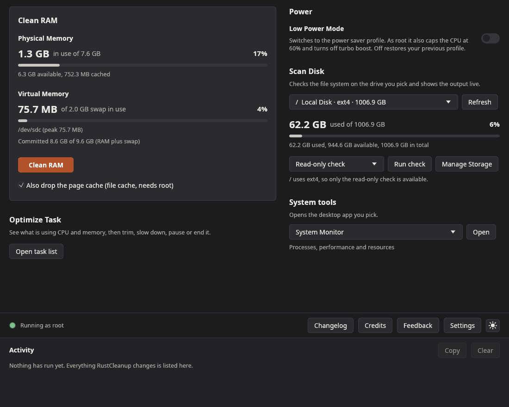
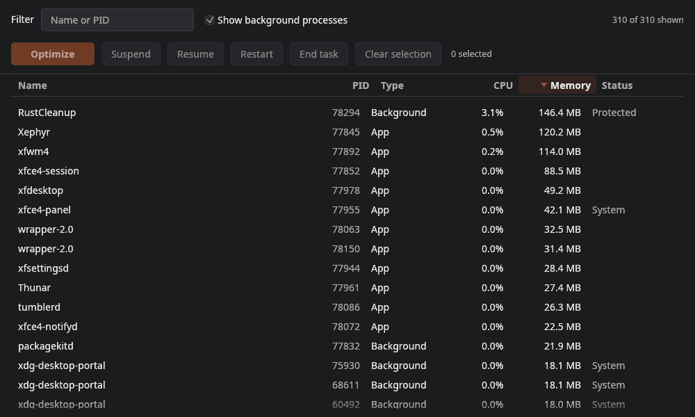
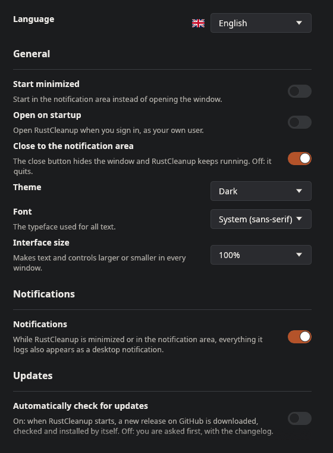

<p align="center">
  
</p>

<p align="center">
  <b>A small, fast system optimizer for Windows 11 and Linux, built in Rust.</b><br>
  Clean RAM, check disks, tame background apps and switch off what you don't want, all from one window.
</p>

<p align="center">
  <a href="https://github.com/RealAnxiousGit/RustCleanup/releases/latest"><b>Download the latest release</b></a>
</p>

| | Windows 11 (x64) | Linux (x86_64, X11 or Wayland) |
|---|---|---|
| **Download** | `RustCleanup.exe` | `RustCleanup-x86_64.AppImage`, or `RustCleanup-<version>-linux-x86_64.tar.gz` |
| **Rights** | Asks for Administrator rights (UAC) at launch | Runs as you; **Restart as root** (through `pkexec`) unlocks the rest |
| **Settings** | `HKCU\Software\RustCleanup` | `~/.config/RustCleanup/settings.conf` |

> RustCleanup changes system settings (registry policies, services, power plans on Windows;
> power profiles and CPU limits on Linux). Every switch can be turned off again to restore the
> default. On Windows it's still a good idea to create a restore point first (`Win + R`, then
> `SystemPropertiesProtection`).

## Features

<table>
  <tr>
    <th>Windows 11</th>
    <th>Linux</th>
  </tr>
  <tr>
    <td></td>
    <td></td>
  </tr>
</table>

The interface, Activity log, task list, Settings, Changelog and Feedback window are the same on both systems. What happens underneath is native to each one:

| Feature | Windows 11 | Linux | How to undo |
|---|---|---|---|
| **Clean RAM** | Trims the working set of every process (`EmptyWorkingSet`), flushes the modified page list and, optionally, purges the standby list (file cache) via `NtSetSystemInformation`. | Syncs, then pages out every process with `process_madvise(MADV_PAGEOUT)`. Without root it uses your session's cgroup `memory.reclaim` instead. Purging the file cache runs `drop_caches` and `compact_memory` (root). | Nothing to undo: memory is paged back in on demand. |
| **Physical Memory** | Live RAM in use, out of usable and installed RAM, plus available and cached memory, refreshed every second. The bar turns yellow above 75% and red above 90%. | The same, from `/proc/meminfo`. | n/a |
| **Virtual Memory** | Page file size, usage and peak for each page file, plus the commit charge. | Swap devices and files (including zram) with their size and use, plus the commit charge. | n/a |
| **Scan Disk** | Used, available and total space of the selected drive. **Manage Storage** opens Windows Settings at Storage. Runs `chkdsk X:` (read-only) or `chkdsk X: /scan` (NTFS) with live output. | The same figures per mount. **Manage Storage** opens Disk Usage Analyzer, Filelight or QDirStat. Runs the right checker for the filesystem, all safe on a mounted disk: `e2fsck -n -f`, `btrfs scrub`, `xfs_scrub`, `fsck.fat -n`, `fsck.exfat -n`, `fsck.f2fs --dry-run`, `ntfsfix -n`. | Read-only checks never modify the disk. |
| **Optimize Task** | A live task list (App or Background, CPU %, memory, status) with filter, sorting and File Explorer style selection. **Optimize** trims memory and sets Below Normal priority; **Suspend**, **Resume**, **Restart**, **End task**. | The same list from `/proc`. **Optimize** pages the process out, sets nice 10 and idle disk priority; Suspend and Resume are `SIGSTOP` and `SIGCONT`; End sends `SIGTERM`, then `SIGKILL` after 3 seconds. | Resume suspended processes. Anything still suspended is resumed when RustCleanup exits. |
| **Low Power Mode** | Creates and activates a "RustCleanup Low Power" plan: CPU capped at 60% plugged in and 50% on battery, turbo boost off, passive cooling. | Switches power-profiles-daemon to **power-saver**; as root it also caps the CPU at 60% and turns turbo boost off. | Switch off: your previous plan or profile and CPU limits come back. |
| **Disable Copilot** | Sets `TurnOffWindowsCopilot = 1` (HKCU and HKLM policies), hides the taskbar button, can restart Explorer. | Windows only. | Switch off: the values are deleted. |
| **Disable Telemetry** | `AllowTelemetry = 0`, disables `DiagTrack` and `dmwappushservice` and the telemetry scheduled tasks. | Windows only. | Switch off: policies removed, services and tasks restored. |
| **No Forced Updates** | `NoAutoRebootWithLoggedOnUsers = 1`, `AUOptions = 2` (ask before download and install); can pause updates for 35 days. | Windows only. | Switch off: all policy and pause values removed. |
| **System Tools** | Power Config, Disk Cleanup, Disk Management, Performance Monitor, Task Manager, Resource Monitor, Windows Security, Device Manager, Settings, Command Prompt, Command Prompt [Admin]. | System Monitor, Disk Usage Analyzer, Disks, Power Settings, System Logs, Software Updates, Hardware Information, Settings, Terminal, Terminal [Root]. Each picks the app your desktop has (GNOME, KDE, Xfce and others). | n/a |
| **Feedback** | A Compose Feedback window for a **Bug Report** or **Suggestion**, with pasted screenshots and hyperlinks. **Send** opens a filled-in GitHub issue and a folder with the screenshots; **Send it by email instead** works without a GitHub account. Nothing is sent until you submit it yourself. | The same. | n/a |

### Task list

<table>
  <tr>
    <th>Windows 11</th>
    <th>Linux</th>
  </tr>
  <tr>
    <td></td>
    <td></td>
  </tr>
</table>

Click any column to sort by it, and again to reverse. Select like in a file manager: click, Ctrl+click, Shift+click, Ctrl+A. Memory turns yellow at 4% and red at 10% of your RAM.

### Tray icon and notifications
- **The tray icon stays** while RustCleanup runs. Click it to open the window.
- **Closing the window hides RustCleanup** to the tray, so it keeps running (you can turn this off in Settings).
- **Right-click the tray icon** for **Open App**, **Clean RAM**, **Open task list**, **Settings**, **Feedback**, **Credits** and **Exit**. The task list, Settings, Feedback and Credits open on their own, without the main window. Only **Exit** quits.
- While the window is minimized or in the tray, finished jobs, warnings and errors from the Activity log also appear as desktop notifications.
- **Only one copy runs.** Opening RustCleanup again brings up the copy that is already running.
- **On Linux** the tray needs a panel with StatusNotifierItem support: KDE, Cinnamon, Xfce, MATE and Ubuntu's GNOME have it, while plain GNOME (Fedora, Arch) needs the AppIndicator extension. Without one, RustCleanup still runs, and closing the window quits it.

### Settings

<table>
  <tr>
    <th>Windows 11</th>
    <th>Linux</th>
  </tr>
  <tr>
    <td></td>
    <td></td>
  </tr>
</table>

The **Settings** button sits between **Credits** and the theme button. **Changelog**, next to **Credits**, shows the release notes of every version, newest first, with a menu to jump to a version and the What's New video. It also opens by itself on the first start after an update.

| Setting | What it does |
|---|---|
| **Language** | English, Español, Português, Français, Deutsch, Italiano, Nederlands, Polski, Türkçe, Русский, 日本語, 中文. Follows your system language on first launch. |
| **Start minimized** | Starts in the tray instead of opening the window. |
| **Open on startup** | Windows: a Task Scheduler logon task with highest privileges, so RustCleanup starts at sign-in without a UAC prompt. Linux: an autostart entry in `~/.config/autostart/rustcleanup.desktop`. |
| **Close to the notification area** | On: the close button hides the window. Off: it quits. |
| **Theme** and **Interface size** | Same as the system, Light or Dark; 90% to 175%. |
| **Font** | Windows: System (Segoe UI), Arial, Times New Roman, Light UI, Comic Sans MS, Verdana, Georgia, Tahoma, Calibri, Trebuchet MS or Consolas. Linux: the same names, mapped to the closest installed font (Liberation, Carlito, DejaVu, Comic Neue, Gelasio, Ubuntu, monospace). |
| **Notifications** | Turns the desktop notifications off or on. |
| **Automatically check for updates** | On: a new release (the exe, or the AppImage on Linux) is downloaded, checked against its published SHA-256, installed, and RustCleanup restarts on the new version by itself. Off: RustCleanup shows the new version's changelog with **Update Now** and **Never Update**. |
| **Auto-Clean RAM** | Cleans RAM by itself when memory use goes above the amount on the slider (50% to 95%), at most once every 2 minutes. |
| **Hardware-accelerated UI** | Draws the interface with Direct3D 12 (Windows) or Vulkan (Linux) instead of OpenGL. Smoother on some GPUs, but uses several times more memory. Needs a restart. |

### Light and dark mode
The button to the right of **Settings** switches themes: a sun means "switch to Light Mode", a crescent moon means "switch to Dark Mode". The change fades over about a quarter of a second, or happens instantly if animation effects are turned off. On first launch RustCleanup follows your system theme (the Windows app theme, or the GNOME, KDE or GTK dark preference), then remembers your choice.

### Safety built in
- **Protected processes.** On Windows csrss, wininit, winlogon, services, lsass, Defender and others; on Linux systemd, init, the journal, udev, logind, D-Bus, the display server and the desktop shell. They can't be suspended or ended, and neither can RustCleanup itself.
- **Desktop components.** Explorer, dwm, svchost and similar show as **System** in the Windows task list. Like in Task Manager they can be ended and Windows starts them again; Explorer can be restarted with your normal rights. RustCleanup warns before acting on them.
- **End task asks first.** It lists which programs will lose unsaved work.
- **Switches show the real state.** They are read back from the system on launch and after every change, so a failed change never leaves a switch showing the wrong state.
- **Nothing is left behind.** Suspended processes are resumed and running scans are stopped when RustCleanup exits.
- **No surprise programs.** Windows tools are started by their full `System32` path, never looked up on `PATH`. Links and normal terminals open as you, never with admin or root rights, even when RustCleanup itself runs elevated.
- **No scripts.** RustCleanup never runs PowerShell or any other script host. Windows scheduled tasks are changed through the Task Scheduler API.
- **No crash on errors.** System calls never `unwrap()`. Every failure is written to the Activity log.

## Using it

### Windows 11
1. Download `RustCleanup.exe` from [Releases](https://github.com/RealAnxiousGit/RustCleanup/releases/latest).
2. Double-click it and choose **Yes** on the UAC prompt (Administrator rights are required).
3. Use the buttons and switches. Everything RustCleanup does is written to the **Activity** log. **Copy** puts the log on the clipboard.

Windows SmartScreen may warn about an unsigned app: click **More info**, then **Run anyway**. Check the download against `RustCleanup.exe.sha256` with `certutil -hashfile RustCleanup.exe SHA256`. If an antivirus flags it, see [False positives](#false-positives).

### Linux
1. Download `RustCleanup-x86_64.AppImage` from [Releases](https://github.com/RealAnxiousGit/RustCleanup/releases/latest).
2. Make it executable and run it:
   ```bash
   chmod +x RustCleanup-x86_64.AppImage
   ./RustCleanup-x86_64.AppImage
   ```
3. It runs as your own user. Choose **Restart as root** in the bottom bar (it asks for your password through `pkexec`) for the features that need root: dropping the file cache, CPU limits, cleaning other users' processes and checking disks.

It works on Ubuntu 20.04 or newer, Linux Mint 20+, Debian 11+, Fedora 32+, openSUSE Leap 15.3+, Arch and other distros from the same years, and it does not need `libfuse2`. The `.tar.gz` holds the same program as a plain binary. Check either download with `sha256sum -c` against its `.sha256` file.

Optional at run time: `pkexec` (Restart as root), `baobab`, `filelight` or `qdirstat` (Manage Storage), `power-profiles-daemon` (Low Power Mode), `ffmpeg` (the Changelog video) and `fonts-noto-cjk` (Japanese and Chinese).

### False positives
2.0.1 was flagged by Microsoft Defender as `Trojan:Win32/Bearfoos.A!ml`. That is a machine-learning guess, not a known virus: 2.0.1 ran hidden PowerShell to create its startup task, which is also what a lot of malware does. 2.0.2 removes all PowerShell use. The exe is not code-signed yet, and new unsigned programs are judged by behaviour, so if your antivirus still flags it, please report it as a false positive (for Defender: https://www.microsoft.com/en-us/wdsi/filesubmission). The source and build steps are below, so you can also build it yourself.

### Notes
- Windows 11 Home and Pro treat `AllowTelemetry = 0` as "Required" (level 1), the lowest level those editions allow. Enterprise and Education honour level 0.
- Copilot policies are written to the signed-in user's `HKCU`. If you elevate with a different admin account, the HKLM policy still applies machine-wide.
- On recent Windows 11 builds Copilot is also a Store app. The policy hides and disables it; you can uninstall the app in Settings, Apps.
- Purging the standby list (Windows) or dropping the page cache (Linux) clears the file cache, so the next launch of a recently used program may be slightly slower.
- A read-only check of a large exFAT drive can take many minutes. The progress line in the Scan Disk window keeps updating while it runs.

## Building from source
One codebase builds both versions. Everything that talks to the system sits in `src/sys/`, with the Linux side in `src/sys/linux/` behind the same functions; the interface in `src/ui/` is shared. [`docs/LINUX.md`](docs/LINUX.md) explains how the two sides mirror each other.

### Windows 11 (x64)
1. **Rust** (stable, MSVC toolchain): install from <https://rustup.rs>, or run
   ```powershell
   winget install Rustlang.Rustup
   ```
2. **Visual Studio Build Tools** with the *Desktop development with C++* workload, which provides the MSVC linker, `rc.exe` and the Windows SDK:
   ```powershell
   winget install Microsoft.VisualStudio.2022.BuildTools --override "--quiet --add Microsoft.VisualStudio.Workload.VCTools --includeRecommended"
   ```
3. Build:
   ```powershell
   git clone https://github.com/RealAnxiousGit/RustCleanup
   cd RustCleanup
   cargo build --release
   ```

The output is `target\release\RustCleanup.exe`, a single self-contained file:
- `build.rs` uses `embed-resource` to compile `resources.rc`, which embeds `app.manifest` (`requireAdministrator`, PerMonitorV2 DPI awareness), the icon and the version info. The build fails if the manifest can't be embedded, so you can never get an exe that silently runs without admin rights.
- `.cargo/config.toml` links the C runtime statically (`+crt-static`), so the exe doesn't need the Visual C++ Redistributable.
- eframe is built with the OpenGL (`glow`) renderer instead of its default wgpu renderer, which keeps memory use low.

Run it by double-clicking the exe and accepting the UAC prompt, or with `cargo run --release` from an **Administrator** terminal. From a normal terminal `cargo run` fails with *"The requested operation requires elevation (os error 740)"*, which shows the manifest is working.

### Linux (x86_64)
Install Rust from <https://rustup.rs>, then the build packages (Debian or Ubuntu names):
```bash
sudo apt install build-essential pkg-config libxkbcommon-dev libwayland-dev libx11-dev libxcursor-dev libxrandr-dev libxi-dev libgl1-mesa-dev libdbus-1-dev fontconfig
git clone https://github.com/RealAnxiousGit/RustCleanup
cd RustCleanup
cargo build --release
```
The output is `target/release/RustCleanup`, which needs the same or a newer glibc than the machine that built it. [`docs/LINUX.md`](docs/LINUX.md) shows the release build that runs on older distros too, and how the AppImage is made.

### Tests
On Windows the test binary carries the same manifest. To run the tests without elevating, tell Windows to ignore the manifest for this shell:
```powershell
$env:__COMPAT_LAYER = "RunAsInvoker"; cargo test
```
On Linux, plain `cargo test` works. `every_string_is_translated` fails if any of the 11 language files is missing a string. The tests that change system settings are ignored by default; each puts the setting back afterwards. Run them from an **Administrator** terminal on Windows:
```powershell
cargo test -- --ignored --test-threads=1
```
`cargo test desktop_ -- --ignored --test-threads=1`, also from an Administrator terminal, opens every System Tool and the Settings page for each non-system drive, so you can check them by eye.

### RAM stress test (development builds)
Debug builds, and release builds made with `--features stress-test`, can stress-test Clean RAM: helper processes fill RAM with data that cannot be compressed, then Clean RAM runs against them several times and reports what each run freed and how long trimming and purging took. Use **Stress test (development build)** under Clean RAM, or the script:
```powershell
.\scripts\stress-ram.ps1 -SizeMB 4096 -Hogs 8 -Runs 10 -Purge -Csv stress.csv
```
Run it from an **Administrator** terminal to test the real thing; without admin rights only your own processes are trimmed and the standby purge is skipped. The size is capped at 80% of the available RAM. On Linux, `scripts/stress-ram.sh` does the same; run it as root, since freeing other processes' memory and dropping the page cache need root.

### Adding a language
Copy `lang/de.txt` to `lang/<code>.txt`, replace each second line with the translation, then add the language to `Lang` in `src/i18n.rs` (including its `include_str!` line) and a flag in `src/ui/flags.rs`.

## Project layout
The layout follows the code graph in [`docs/graphify/GRAPH_REPORT.md`](docs/graphify/GRAPH_REPORT.md): one module per feature, with shared plumbing kept separate. Open [`docs/graphify/graph.html`](docs/graphify/graph.html) in a browser to explore the graph. After changing code, regenerate it with `graphify update src`.

```
src/
├── main.rs             window setup (eframe/egui), single instance, launch flags
├── app.rs              wires sections, windows, tray and theme together
├── events.rs           worker-to-UI messages, Logger, Jobs (panic-safe job runner)
├── settings.rs         preferences (registry on Windows, settings.conf on Linux)
├── i18n.rs             translations (English text is the key, lang/*.txt)
├── background.rs       launch-time update and startup checks, Auto-Clean RAM
├── ui/                 the interface, shared by both systems
│   ├── memory.rs       Clean RAM: Physical and Virtual Memory
│   ├── disk.rs         Scan Disk and the disk check output window
│   ├── tasks.rs        Optimize Task and the task list window
│   ├── tweaks.rs       system settings switches and System tools
│   ├── feedback.rs     Compose Feedback window
│   ├── credits.rs      Credits window
│   ├── changelog.rs    Changelog window (every release's notes, with a version menu)
│   ├── video_player.rs What's New video player (controls, volume, full screen, keys)
│   ├── settings.rs     Settings window
│   ├── update.rs       new-version window with the changelog
│   ├── flags.rs        flags for the language picker
│   ├── activity.rs     Activity log
│   ├── theme.rs        palettes, fonts, theme fade
│   └── widgets.rs      switch, meter, buttons, theme button, links
└── sys/                everything that talks to the system (no UI code)
    ├── mod.rs          picks the Windows modules or sys/linux/ at compile time
    ├── memory.rs       memory figures, EmptyWorkingSet, standby purge
    ├── disk.rs         drive enumeration and free space
    ├── chkdsk.rs       streaming chkdsk runner
    ├── copilot.rs      Copilot policy
    ├── telemetry.rs    telemetry policies, services, tasks
    ├── updates.rs      Windows Update policies and pause
    ├── power.rs        Low Power Mode plan via powercfg
    ├── process_monitor.rs  task list sampling (sysinfo)
    ├── process_actions.rs  optimize, suspend, resume, restart, end
    ├── tray.rs         tray icon, menu, notifications (Shell_NotifyIconW)
    ├── tools.rs        System Tools launchers
    ├── updater.rs      GitHub release check, download, SHA-256 check, file swap (both systems)
    ├── startup.rs      Open on startup (Task Scheduler logon task)
    ├── tasks.rs        Task Scheduler API (ITaskService)
    ├── storage_page.rs drive page in Settings, found with UI Automation
    ├── single_instance.rs  one running copy; a second launch shows the first
    ├── shell.rs        Explorer restart, unelevated links and programs, window helpers
    ├── video.rs        Changelog video playback (Media Foundation)
    ├── mail.rs         which app opens email links (both systems)
    ├── stress.rs       RAM stress test for development builds (both systems)
    ├── com.rs          COM setup for the API modules
    ├── command.rs      hidden console tools and output decoding
    ├── privilege.rs    elevation check, token privileges
    ├── registry.rs     winreg helpers
    ├── format.rs       sizes and dates (both systems)
    ├── admin_tests.rs  ignored tests that change system settings
    ├── desktop_tests.rs  ignored tests that open every tool for a visual check
    └── linux/          the same functions for Linux
        ├── memory.rs       /proc/meminfo, swap, process_madvise, cgroup reclaim, drop_caches
        ├── disk.rs         mounts and free space
        ├── chkdsk.rs       read-only filesystem checks with live output
        ├── power.rs        power-profiles-daemon, CPU cap, turbo
        ├── process_monitor.rs  task list from /proc, protected processes
        ├── process_actions.rs  page out, nice, SIGSTOP/SIGCONT, SIGTERM/SIGKILL
        ├── tray.rs         StatusNotifierItem tray (ksni) and notifications (notify-rust)
        ├── tools.rs        System Tools for GNOME, KDE, Xfce and others
        ├── startup.rs      autostart .desktop entry
        ├── storage_page.rs Manage Storage in a disk usage viewer
        ├── single_instance.rs  lock file and Unix socket
        ├── shell.rs        xdg-open, theme detection, email handler
        ├── privilege.rs    root check, Restart as root through pkexec
        ├── user.rs         the desktop user, even when running as root
        ├── registry.rs     settings.conf behind the registry functions
        ├── command.rs      background commands and output decoding
        └── video.rs        Changelog video through ffmpeg and ffplay
lang/                   one file per language: English line, then its translation
patches/eframe/         eframe 0.37.0 with a fix for closing windows (see patches/README.md)
scripts/                RAM stress test scripts (stress-ram.ps1, stress-ram.sh)
docs/                   screenshots, banner, LINUX.md, What's New videos, code graph
DESIGN.md               design direction and the reason for each choice
app.manifest            UAC requireAdministrator manifest (Windows)
resources.rc            embeds manifest, icon and version info (Windows)
build.rs                compiles resources.rc into the exe (Windows)
```

## How it stays responsive
The UI thread only draws and reads channels. Each operation runs on its own worker thread through `Jobs::start`, which reports progress as `AppEvent`s and wakes the UI with `request_repaint`. The window repaints once a second for the live memory figures and otherwise only when something changes. Disk check output is read by dedicated reader threads, and the task list is sampled every 2 seconds by a background thread only while its window is open. The tray icon has its own thread, so its menu works while the main window is hidden.

## Credits
- Programming: Claude Opus 5.5
- Prompt Engineer: Nicholas Slaughter
- Toolkits: [graphify](https://github.com/Graphify-Labs/graphify) (code graph used to plan the module layout) and [anti-slop](https://github.com/miqdadbadjuber/anti-slop) (design rules applied to the interface)
- Built with [egui/eframe](https://github.com/emilk/egui), [sysinfo](https://github.com/GuillaumeGomez/sysinfo), [windows-rs](https://github.com/microsoft/windows-rs), [winreg](https://github.com/gentoo90/winreg-rs), [embed-resource](https://github.com/nabijaczleweli/rust-embed-resource), [ksni](https://github.com/iovxw/ksni) and [notify-rust](https://github.com/hoodie/notify-rust)

## License
[MIT](LICENSE)
